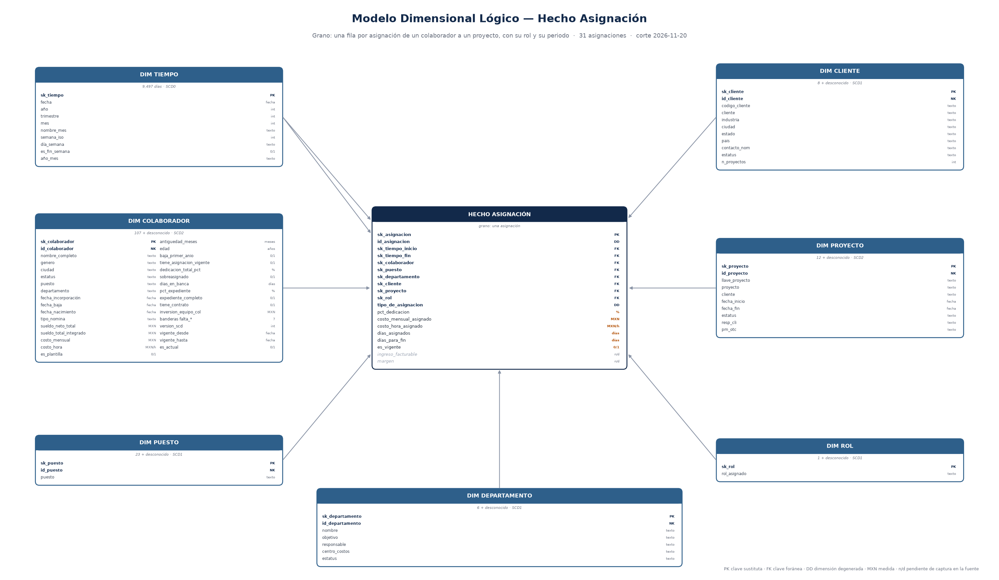
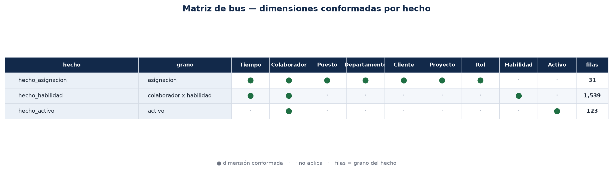

# Etapa 4 — Modelo Dimensional Lógico

**Reto de Business Intelligence — Socio formador OTC Consulting**  
**José Fernando Munguía Zertuche — A01199357**  
**23 de noviembre de 2026**

Este documento diseña el modelo dimensional que responde a las preguntas de análisis del reto a partir de las tablas acondicionadas en la Etapa 3. El diseño sigue el proceso de cuatro pasos de Kimball y se entrega en dos partes: el diseño conceptual (sección A) y el modelo lógico con la definición de la tabla de hechos y de cada dimensión (sección B).

El diagrama no está dibujado a mano: se genera con Python y Matplotlib desde el cuaderno `notebooks/ETAPA_4_MODELO_DIMENSIONAL_OTC.ipynb`, que también valida el grano, la integridad referencial y las cardinalidades contra los datos reales. Las imágenes quedan en `docs/modelo_dimensional_logico.png` y `docs/matriz_bus.png`.

## Resumen del modelo

| Proceso de negocio | Grano | Filas | Tabla de hechos | Dimensiones |
|---|---|---:|---|---|
| Asignación y costeo del capital humano | Una fila por asignación de un colaborador a un proyecto | 31 | `hecho_asignacion` | Tiempo, Colaborador, Puesto, Departamento, Cliente, Proyecto, Rol |
| Evaluación de habilidades | Una fila por colaborador y habilidad evaluada | 1,539 | `hecho_habilidad` | Tiempo, Colaborador, Habilidad |
| Inventario y resguardo de activos | Una fila por activo del inventario | 123 | `hecho_activo` | Tiempo, Colaborador, Activo |

Nueve dimensiones, de las cuales Tiempo y Colaborador son conformadas: las comparten los tres hechos.

---

# A. Diseño conceptual

## A.1 Los cuatro pasos de la metodología de Kimball

Kimball y Ross plantean el diseño dimensional como una secuencia de cuatro decisiones que se toman antes de escribir una sola tabla: elegir el proceso de negocio, declarar la granularidad, identificar las dimensiones e identificar los hechos. Aplicados al reto, estos son los pasos y su resultado.

| Paso | Pregunta que responde | Decisión en este reto | Evidencia |
|---|---|---|---|
| 1. Elegir el proceso de negocio | ¿Qué evento del negocio se quiere medir? | La asignación de consultores a proyectos de clientes y su costo, porque es donde se genera el margen de OTC | 31 asignaciones, 3 clientes y 4 proyectos en la tabla acondicionada |
| 2. Declarar la granularidad | ¿Qué representa exactamente una fila de la tabla de hechos? | Una asignación: un colaborador en un proyecto, con su rol y su periodo | `id_asignacion` es único en las 31 filas |
| 3. Identificar las dimensiones | ¿Desde qué perspectivas se puede analizar ese evento? | Siete dimensiones para la asignación y dos más para los hechos de habilidades y activos | 9 dimensiones, 2 de ellas conformadas |
| 4. Identificar los hechos | ¿Qué números se miden y cómo se agregan? | Seis medidas disponibles y dos pendientes de captura en la fuente | Costo asignado de $2,025,644.02 y 100% de dedicación |

El paso 1 se aplicó tres veces porque el reto tiene tres procesos de negocio distintos, no uno. El resultado es una constelación de tres hechos que comparten dimensiones, y no una sola tabla de hechos forzada a contener habilidades y activos, que tienen granos diferentes. La asignación es el hecho central porque es el que explica la utilización y el costo, que son las dos preguntas con más peso en el reto.

## A.2 Objeto de estudio

El hecho a analizar es la asignación de consultores a proyectos de clientes y su costo. OTC Consulting vende horas y conocimiento, así que su margen depende de cuántos consultores están en proyecto y de cuánto cuesta cada uno. La unidad de análisis principal es el par formado por un colaborador y un proyecto en un periodo; a esa unidad se le agregan las perspectivas del colaborador, el puesto, el área, el cliente, el proyecto y el rol.

Los tres procesos que se modelan son:

| Proceso | Qué registra | Grano | Por qué se modela aparte |
|---|---|---|---|
| Asignación | Quién trabaja en qué proyecto, con qué rol y en qué periodo | Asignación | Es el evento que explica utilización, costo asignado y margen |
| Habilidad | Qué nivel tiene cada colaborador en cada habilidad | Colaborador × habilidad | Un colaborador tiene muchas habilidades y un proyecto requiere varias; mezclarlo con la asignación multiplicaría filas |
| Activo | Qué equipo tiene cada colaborador y cuánto vale | Activo | El inventario se controla por activo, no por asignación; un consultor puede tener varios equipos |

## A.3 Granularidad

**Declaración del grano.** Una fila de `hecho_asignacion` representa una asignación registrada de un colaborador a un proyecto, con su rol y su periodo. La llave natural es `id_asignacion` y el grano se declara a nivel de asignación, no de día ni de mes, porque la fuente no registra horas ni cambios diarios: registra la colocación completa.

**Validación con los datos.** El cuaderno comprueba tres cosas antes de aceptar el grano:

- `id_asignacion` es único en las 31 filas y no hay duplicados de la combinación colaborador, proyecto y fecha de inicio.
- Las 31 asignaciones involucran a 30 colaboradores (una persona tiene dos asignaciones), 3 clientes y 4 proyectos.
- Las llaves foráneas no tienen huérfanos: todas las asignaciones apuntan a un colaborador, un proyecto y un cliente que existen en sus catálogos.

**Qué grano se descartó y por qué.**

- *Horas por semana*: la tabla `registro_horas` está vacía. El modelo reserva un hecho futuro para cuando el socio capture horas, pero hoy no se puede construir.
- *Snapshot mensual del colaborador*: no hay historial de sueldos ni de estatus. Un snapshot mensual solo repetiría la foto del corte y daría una falsa serie de tiempo.
- *Una fila por colaborador*: respondería la pregunta de plantilla, pero no la de quién está en qué proyecto, que es el objeto de estudio.

**Granos de los hechos secundarios.**

| Hecho | Grano | Filas | Casos especiales |
|---|---|---:|---|
| `hecho_habilidad` | Colaborador × habilidad | 1,539 | 10 filas de la matriz no traen colaborador y se cargan con el miembro desconocido, no se eliminan |
| `hecho_activo` | Activo | 123 | 32 activos no tienen resguardo y se cargan con el miembro desconocido |

**Consecuencias del grano elegido.** De las 31 asignaciones, 21 no tienen fecha de inicio real porque la fuente trae la fecha centinela 1990-01-01 y el acondicionamiento la dejó nula; por eso `dias_asignados` solo se puede calcular en 10. Además, 29 de las 31 no tienen rol capturado y las 31 tienen dedicación del 100%, así que la medida existe y el modelo la soporta, pero hoy no varía. El modelo no esconde esos huecos: los representa con llaves desconocidas y con medidas nulas.

## A.4 Métricas identificadas

Una métrica es una medida numérica que se puede agregar a lo largo de al menos una dimensión. En el modelo se separan de los atributos derivados que describen a la persona (antigüedad, edad, días en banca), porque esos no se suman entre filas: se consultan al corte.

| Métrica | Fórmula | Aditividad | Unidad | Cobertura | Valor en la corrida |
|---|---|---|---|---:|---|
| `pct_dedicacion` | `asignacion.pct_dedicacion` | No aditiva | % | 31 de 31 | 100% en todas |
| `costo_mensual_asignado` | `costo_mensual × pct_dedicacion / 100` | Aditiva | MXN al mes | 31 de 31 | $2,025,644.02 |
| `costo_hora_asignado` | `costo_hora × pct_dedicacion / 100` | No aditiva | MXN por hora | 31 de 31 | Se calcula por fila |
| `dias_asignados` | `(fecha_fin o corte) − fecha_inicio` | Aditiva | Días | 10 de 31 | Nulo cuando no hay inicio real |
| `dias_para_fin` | `fecha_fin − fecha_corte` | No aditiva | Días | 7 de 31 | 42, 223 y 589 |
| `es_vigente` | `estatus = En Curso` | Flag | 0 o 1 | 31 de 31 | 31 vigentes |
| `ingreso_facturable` | `tarifa_hora × horas_facturables` | Aditiva | MXN | 0 de 31 | Pendiente: tarifas y horas vacías |
| `margen` | `ingreso_facturable − costo_mensual_asignado` | Aditiva | MXN | 0 de 31 | Pendiente de la métrica anterior |
| `nivel_num` (habilidad) | Escala Básico 1 a Experto 4 | No aditiva | Nivel | 1,539 de 1,539 | 1 a 4 |
| `brecha_nivel` (habilidad) | `nivel_requerido − nivel_num` | No aditiva | Nivel | 0 de 1,539 | Pendiente: no hay nivel requerido por proyecto |
| `costo_activo` (activo) | `activo.costo` | Aditiva | MXN | 53 de 123 | $567,915.55 |
| `costo_pendiente` (activo) | `costo` si el resguardo está abierto y la persona ya salió | Aditiva | MXN | 9 de 123 | $40,693.00 |

**Por qué el sueldo no es una medida del hecho de asignación.** El sueldo describe a la persona al corte, no al evento. Si se pusiera en el hecho, una persona con dos asignaciones lo sumaría dos veces y la nómina saldría inflada. Por eso `costo_mensual` vive en `dim_colaborador` y el hecho guarda solo la parte prorrateada por dedicación, que es la que sí se puede sumar sin duplicar.

**Por qué la dedicación es la única medida que se prorratea.** La regla de negocio de la Etapa 2 dice que un colaborador puede estar en varias asignaciones solo si se registra su porcentaje. El modelo aplica esa regla: `costo_mensual_asignado` usa el porcentaje y no el costo completo, de modo que la suma de las asignaciones de una persona nunca exceda su costo.

## A.5 Perspectivas de análisis (dimensiones)

Las dimensiones son las perspectivas desde las cuales se mira el hecho. Se eligieron por las preguntas de análisis y por los atributos que ya existen en las tablas acondicionadas, no por la forma de los archivos.

| Dimensión | Qué describe | Filas | Llave natural | SCD | Hechos que la usan |
|---|---|---:|---|---|---|
| `dim_tiempo` | El calendario de los eventos | 9,497 | `sk_tiempo` (AAAAMMDD) | 0 | Los tres |
| `dim_colaborador` | A la persona y su situación al corte | 107 + desconocido | `id_colaborador` | 2 | Los tres |
| `dim_puesto` | El puesto del catálogo | 23 + desconocido | `id_puesto` | 1 | Asignación |
| `dim_departamento` | El área, su responsable y su centro de costos | 6 + desconocido | `codigo` | 1 | Asignación |
| `dim_cliente` | Al cliente y su industria | 8 + desconocido | `id_cliente` | 1 | Asignación |
| `dim_proyecto` | Al proyecto, sus fechas y su gerente | 12 + desconocido | `id_proyecto` | 2 | Asignación |
| `dim_rol` | El rol desempeñado en la asignación | 1 + desconocido | `rol_asignado` | 1 | Asignación |
| `dim_habilidad` | La habilidad, su tecnología y su tipo | 71 + desconocido | `cod_habilidad` | 1 | Habilidad |
| `dim_activo` | El equipo, su marca y su serie | 123 + desconocido | `codigo` | 1 | Activo |

**Dimensiones conformadas.** Tiempo y Colaborador las comparten los tres hechos, lo que permite comparar utilización, habilidades y equipo de la misma persona y en el mismo calendario sin reconciliar catálogos.

**Dimensiones con roles.** `dim_tiempo` se usa tres veces en el hecho de asignación: fecha de inicio, fecha de fin y fecha de corte. En el modelo lógico son tres llaves foráneas a la misma dimensión, no tres tablas de tiempo distintas.

**Por qué el rol es una dimensión y no una columna más.** El rol es una perspectiva de análisis (consultor funcional, gerente de proyecto) y va a crecer cuando el socio corrija la captura. Hoy tiene un solo valor y 29 asignaciones sin rol; aun así se modela como dimensión para que el análisis por rol no dependa de texto libre.

## A.6 Diagrama del diseño conceptual



El diagrama se lee de adentro hacia afuera: la caja central es el hecho con su grano, sus llaves y sus medidas; las cajas de los extremos son las dimensiones con sus atributos. Las flechas van de la dimensión al hecho y representan la llave foránea. `PK` es la clave sustituta, `FK` la foránea, `DD` una dimensión degenerada, `NK` la llave natural y las etiquetas en ámbar son medidas. El miembro desconocido de cada dimensión es la llave 0 y no aparece como caja para no duplicar el diagrama.

La matriz de bus muestra qué dimensión comparte cada hecho y confirma que no hay dimensiones exclusivas que impidan comparar los tres procesos.



---

# B. Modelo lógico

## B.1 Definición de la tabla de hechos y sus atributos

### B.1.1 `hecho_asignacion`

Es la tabla central. Tiene 31 filas, una por asignación, y su grano está declarado en A.3. La llave primaria es sustituta y las llaves foráneas apuntan a las siete dimensiones; las medidas son las que se definieron en A.4.

| Columna | Tipo | Llave | Origen o fórmula | Descripción |
|---|---|---|---|---|
| `sk_asignacion` | entero | PK | Secuencial 1 a 31 | Clave sustituta del hecho |
| `id_asignacion` | entero | DD | `asignacion.id_asignacion` | Folio natural de la asignación; dimensión degenerada |
| `sk_tiempo_inicio` | entero | FK `dim_tiempo` | AAAAMMDD de `fecha_inicio`; 0 si es nula | Fecha en que inicia la asignación |
| `sk_tiempo_fin` | entero | FK `dim_tiempo` | AAAAMMDD de `fecha_fin`; 0 si sigue abierta | Fecha en que termina |
| `sk_colaborador` | entero | FK `dim_colaborador` | Mapa de `id_colaborador` | Persona asignada |
| `sk_puesto` | entero | FK `dim_puesto` | Puesto del colaborador al corte; 0 si es nulo | Puesto con el que se le asigna |
| `sk_departamento` | entero | FK `dim_departamento` | Área del colaborador al corte; 0 si es nula | Área que paga el costo |
| `sk_cliente` | entero | FK `dim_cliente` | Mapa de `id_cliente` | Cliente del proyecto |
| `sk_proyecto` | entero | FK `dim_proyecto` | Mapa de `id_proyecto` | Proyecto asignado |
| `sk_rol` | entero | FK `dim_rol` | Rol capturado; 0 si es nulo | Rol desempeñado |
| `tipo_de_asignacion` | texto | DD | `tipo_de_asignacion` | Asignación o Proyecto |
| `pct_dedicacion` | decimal | Medida | `pct_dedicacion` | Porcentaje del tiempo dedicado |
| `costo_mensual_asignado` | decimal | Medida | `costo_mensual × pct_dedicacion / 100` | Costo mensual imputado a la asignación |
| `costo_hora_asignado` | decimal | Medida | `costo_hora × pct_dedicacion / 100` | Costo por hora imputado |
| `dias_asignados` | entero | Medida | `(fecha_fin o corte) − fecha_inicio` | Duración de la asignación |
| `dias_para_fin` | entero | Medida | `fecha_fin − fecha_corte` | Días que faltan para que termine |
| `es_vigente` | booleano | Medida | `estatus = En Curso` | Indica si la asignación sigue abierta |
| `ingreso_facturable` | decimal | Medida | `tarifa_hora × horas`; nula hoy | Ingreso que genera la asignación |
| `margen` | decimal | Medida | `ingreso_facturable − costo_mensual_asignado`; nulo hoy | Margen de la asignación |

### B.1.2 `hecho_habilidad`

| Columna | Tipo | Llave | Origen o fórmula | Descripción |
|---|---|---|---|---|
| `sk_habilidad_hecho` | entero | PK | Secuencial | Clave del registro |
| `sk_colaborador` | entero | FK `dim_colaborador` | `matriz.id_colaborador`; 0 si falta | Persona evaluada |
| `sk_habilidad` | entero | FK `dim_habilidad` | `matriz.cod_habilidad` | Habilidad evaluada |
| `sk_tiempo` | entero | FK `dim_tiempo` | Fecha de evaluación; 0 si no existe | Momento de la evaluación |
| `nivel_num` | entero | Medida | Básico 1, Intermedio 2, Avanzado 3, Experto 4 | Nivel en la escala |
| `nivel_txt` | texto | DD | Etiqueta del nivel | Texto original del nivel |
| `brecha_nivel` | entero | Medida | `nivel_requerido − nivel_num`; nula hoy | Distancia contra lo que pide el proyecto |
| `matriz_actualizada` | booleano | Medida | 1 si la evaluación tiene menos de 12 meses; nula hoy | Vigencia de la evaluación |

### B.1.3 `hecho_activo`

| Columna | Tipo | Llave | Origen o fórmula | Descripción |
|---|---|---|---|---|
| `sk_activo_hecho` | entero | PK | Secuencial | Clave del registro |
| `sk_activo` | entero | FK `dim_activo` | `activo.codigo` | Equipo inventariado |
| `sk_colaborador` | entero | FK `dim_colaborador` | Responsable del resguardo; 0 si no tiene | Persona que lo tiene |
| `sk_tiempo_resguardo` | entero | FK `dim_tiempo` | AAAAMMDD de `fecha_ini`; 0 si falta | Inicio del resguardo |
| `costo` | decimal | Medida | `activo.costo` | Valor del equipo |
| `dias_en_resguardo` | entero | Medida | `corte − fecha_ini` | Tiempo que lleva con la persona |
| `pendiente_recuperar` | booleano | Medida | 1 si el responsable está de baja y no hay devolución | Alerta de recuperación |
| `costo_pendiente` | decimal | Medida | `costo × pendiente_recuperar` | Valor en riesgo |

## B.2 Definición de las tablas de dimensión y sus atributos

Convenciones: toda dimensión tiene una clave sustituta entera (`sk_*`), una llave natural (`NK`) que viene de la fuente y una fila 0 para el miembro desconocido. Las dimensiones con historia (`dim_colaborador` y `dim_proyecto`) llevan `version_scd`, `vigente_desde`, `vigente_hasta` y `es_actual`; las de catálogo se actualizan en su lugar (SCD 1).

### B.2.1 `dim_tiempo`

| Columna | Tipo | Llave | Descripción |
|---|---|---|---|
| `sk_tiempo` | entero | PK | AAAAMMDD, de 20030101 a 20281231; 0 es desconocido |
| `fecha` | fecha | | Fecha completa |
| `año` | entero | | Año |
| `trimestre` | entero | | Trimestre del 1 al 4 |
| `mes` | entero | | Mes del 1 al 12 |
| `nombre_mes` | texto | | Nombre del mes |
| `semana_iso` | entero | | Semana ISO |
| `día_semana` | texto | | Día de la semana |
| `es_fin_semana` | booleano | | 1 si es sábado o domingo |
| `año_mes` | texto | | Periodo en formato AAAAMM para tendencias |

### B.2.2 `dim_colaborador`

Conserva la foto del colaborador al corte y la historia cuando cambia su puesto, su área, su sueldo o su estatus. Las etiquetas de puesto y departamento se guardan desnormalizadas a propósito: el hecho solo cubre a 30 personas, mientras que la dimensión permite analizar a las 107, incluidas las que no tienen asignación.

| Columna | Tipo | Llave | Descripción |
|---|---|---|---|
| `sk_colaborador` | entero | PK | Clave sustituta |
| `id_colaborador` | texto | NK | Identificador visible de la fuente |
| `nombre_completo` | texto | | Nombre en formato título |
| `genero` | texto | | Masculino o Femenino |
| `ciudad` | texto | | Ciudad de residencia |
| `estatus` | texto | | Activo o Baja |
| `puesto` | texto | | Puesto al corte, desnormalizado |
| `departamento` | texto | | Área al corte, desnormalizada |
| `fecha_incorporación` | fecha | | Alta en la empresa |
| `fecha_baja` | fecha | | Baja, nula si está activo |
| `fecha_nacimiento` | fecha | | Nacimiento |
| `tipo_nomina` | texto | | IMSS, asimilados, sindicato u otro |
| `sueldo_neto_total` | decimal | | Sueldo neto mensual |
| `sueldo_total_integrado` | decimal | | Base del costo mensual |
| `costo_mensual` | decimal | | Costo mensual para la empresa |
| `costo_hora` | decimal | | Costo mensual entre 160 horas |
| `es_plantilla` | booleano | | 0 para los familiares de seguro |
| `antiguedad_meses` | entero | | Meses desde el alta |
| `edad` | entero | | Años cumplidos |
| `baja_primer_anio` | booleano | | 1 si salió antes de 12 meses |
| `tiene_asignacion_vigente` | booleano | | 1 si tiene al menos una asignación abierta |
| `dedicacion_total_pct` | decimal | | Suma de dedicaciones vigentes |
| `sobreasignado` | booleano | | 1 si la dedicación supera 100% |
| `dias_en_banca` | entero | | Días sin asignación |
| `pct_expediente` | decimal | | Porcentaje de documentos entregados |
| `expediente_completo` | booleano | | 1 si el expediente está al 100% |
| `tiene_contrato` | booleano | | 1 si el contrato está registrado |
| `inversion_equipo_col` | decimal | | Valor del equipo a su resguardo |
| `banderas falta_*` | booleano | | Siete banderas de calidad: puesto, área, nómina, ciudad, fecha de baja, sueldo e inconsistencia de estatus |
| `version_scd` | entero | | Versión de la fila |
| `vigente_desde` | fecha | | Inicio de la versión |
| `vigente_hasta` | fecha | | Fin de la versión, nulo si es la actual |
| `es_actual` | booleano | | 1 en la versión vigente |

### B.2.3 `dim_puesto`

| Columna | Tipo | Llave | Descripción |
|---|---|---|---|
| `sk_puesto` | entero | PK | Clave sustituta |
| `id_puesto` | entero | NK | Identificador del catálogo |
| `puesto` | texto | | Nombre del puesto |

### B.2.4 `dim_departamento`

| Columna | Tipo | Llave | Descripción |
|---|---|---|---|
| `sk_departamento` | entero | PK | Clave sustituta |
| `codigo` | texto | NK | Código del área |
| `nombre` | texto | | Nombre del área |
| `objetivo` | texto | | Objetivo del área |
| `responsable` | texto | | Responsable, hoy nulo |
| `centro_costos` | texto | | Centro de costos, hoy nulo |
| `estatus` | texto | | Estatus del catálogo |

### B.2.5 `dim_cliente`

| Columna | Tipo | Llave | Descripción |
|---|---|---|---|
| `sk_cliente` | entero | PK | Clave sustituta |
| `id_cliente` | entero | NK | Identificador de la fuente |
| `codigo_cliente` | texto | | Código visible |
| `cliente` | texto | | Nombre homologado |
| `industria` | texto | | Industria |
| `ciudad` | texto | | Ciudad |
| `estado` | texto | | Estado |
| `pais` | texto | | País |
| `contacto_nom` | texto | | Contacto del cliente |
| `estatus` | texto | | Activo o inactivo |
| `n_proyectos` | entero | | Proyectos registrados |

### B.2.6 `dim_proyecto`

| Columna | Tipo | Llave | Descripción |
|---|---|---|---|
| `sk_proyecto` | entero | PK | Clave sustituta |
| `id_proyecto` | entero | NK | Identificador generado en el acondicionamiento |
| `llave_proyecto` | texto | | Código del proyecto |
| `proyecto` | texto | | Nombre del proyecto |
| `cliente` | texto | | Cliente, desnormalizado para lectura |
| `fecha_inicio` | fecha | | Inicio del proyecto |
| `fecha_fin` | fecha | | Fin del proyecto |
| `estatus` | texto | | Estatus del proyecto |
| `resp_cli` | texto | | Responsable del cliente |
| `pm_otc` | texto | | Gerente de OTC |

### B.2.7 `dim_rol`

| Columna | Tipo | Llave | Descripción |
|---|---|---|---|
| `sk_rol` | entero | PK | Clave sustituta |
| `rol_asignado` | texto | NK | Rol en la asignación; 0 es desconocido |

### B.2.8 `dim_habilidad`

| Columna | Tipo | Llave | Descripción |
|---|---|---|---|
| `sk_habilidad` | entero | PK | Clave sustituta |
| `cod_habilidad` | texto | NK | Código de la habilidad |
| `descripcion` | texto | | Descripción original |
| `descripcion_unica` | texto | | Descripción desambiguada por tecnología |
| `tecnologia` | texto | | Oracle EBS, Cloud, IA u otra |
| `tipo` | texto | | Dura o blanda |
| `estatus` | texto | | Estatus del catálogo |
| `descripcion_repetida` | booleano | | 1 si comparte descripción con otra tecnología |

### B.2.9 `dim_activo`

| Columna | Tipo | Llave | Descripción |
|---|---|---|---|
| `sk_activo` | entero | PK | Clave sustituta |
| `codigo` | texto | NK | Código del activo |
| `desc` | texto | | Descripción |
| `tipo` | texto | | Tipo de equipo |
| `marca` | texto | | Marca homologada |
| `modelo` | texto | | Modelo |
| `serie` | texto | | Número de serie |
| `proveedor` | texto | | Proveedor |
| `fcompra` | fecha | | Fecha de compra |
| `estatus` | texto | | Estatus del activo |
| `notas` | texto | | Observaciones |

### B.2.10 Columnas de las tablas acondicionadas que quedan fuera del modelo

El modelo no pierde información analítica, pero sí deja fuera columnas que no son atributos dimensionales ni medidas. Su destino es explícito para que se pueda auditar la correspondencia.

- **Colaboradores (62 columnas).** 34 pasan a `dim_colaborador`; `id_puesto` e `id_departamento` se usan para resolver las dimensiones de puesto y área y no se copian; 10 banderas documentales (`doc_acta`, `doc_banco`, `doc_compdom`, `doc_csf`, `doc_curp`, `doc_foto`, `doc_ine`, `doc_nss`, `doc_pasaporte`, `doc_visa`) se quedan en el expediente y no en el modelo; `doc_contrato` se convierte en `tiene_contrato`; 3 avisos de formato (`formato_rh`, `aviso_infonavit`, `aviso_manutencion`) y 3 prestaciones (`segvida`, `sgmm`, `med_condiciones`) son datos de cumplimiento; los 5 componentes del sueldo (`sueldo_imss`, `sueldo_asimilados`, `sueldo_complementos`, `comision_nomina`, `impuestos_imss`) pertenecen a un futuro hecho de nómina; `email` y `telefono` se excluyen por datos personales; `uid` y `notas` se quedan en staging.
- **Asignaciones (29 columnas).** 11 alimentan el hecho; 4 son banderas de calidad (`falta_rol`, `falta_tipo`, `falta_estatus`, `falta_fecha_inicio`) y el resto son etiquetas desnormalizadas (`colaborador`, `puesto_colaborador`, `cliente`, `proyecto`, `codigo_cliente`) o columnas de staging (`inicio`, `fin`, `llave_proyecto`, `pct_dedicacion_estimado`).
- **Proyectos, clientes, habilidades y departamentos.** Se usan sus llaves y atributos descriptivos; los campos de contacto y las banderas `falta_*` se quedan en staging. Los catálogos de homologación no entran al modelo porque ya resolvieron su función en el acondicionamiento.
- **Matriz de habilidades.** Se usan las cuatro columnas; las 10 filas sin colaborador se conservan con `sk_colaborador = 0` para que el total de evaluaciones siga cuadrando.
- **Activos.** Se usan 11 columnas; `costo_desconocido`, `sin_asignar`, `liga_resguardo`, `estatus_colaborador` y `pendiente_recuperar` son banderas de calidad que se recalculan en el ETL del hecho.

## B.3 Diagrama del modelo lógico


El mismo diagrama de A.6 es la vista lógica: cada caja lista las columnas que se definieron en B.1 y B.2. La matriz de bus de A.6 completa la vista al mostrar qué hechos comparten cada dimensión.

## B.4 Decisiones de diseño

1. **Una tabla de hechos por proceso.** Asignación, habilidad y activo tienen granos distintos. Unirlos en una sola tabla obligaría a repetir filas y a inventar medidas nulas; la constelación conserva cada grano y comparte dimensiones.
2. **Claves sustitutas enteras.** El ETL asigna `sk_*` de forma determinista y conserva la llave natural como `NK`. Así el modelo no depende de que la fuente cambie un folio o un nombre.
3. **Miembro desconocido con llave 0.** Las 29 asignaciones sin rol, los 32 activos sin resguardo y las 10 evaluaciones sin colaborador se cargan con la llave 0. No se eliminan: un tablero que esconde registros no es confiable.
4. **Tiempo con llave AAAAMMDD.** La clave del calendario es la fecha en formato entero, no un consecutivo. Facilita la carga, permite generar el rango completo y deja la llave 0 para "sin fecha".
5. **Dimensiones de tiempo con roles.** Inicio, fin y corte son tres llaves foráneas a `dim_tiempo`; no se duplica la tabla ni se pierde la capacidad de filtrar por cualquiera de las tres fechas.
6. **SCD 2 solo donde hay historia que analizar.** Colaborador y proyecto cambian de sueldo, área, estatus y fechas; los catálogos de puesto, área, cliente y habilidad se corrigen en su lugar (SCD 1). Guardar versiones de un catálogo que solo se homologa agrega filas sin habilitar análisis.
7. **Modelo en estrella, no en copo de nieve.** El hecho lleva `sk_cliente` y `sk_proyecto` por separado, y `dim_proyecto` no apunta a `dim_cliente`. Así cada análisis resuelve una sola unión y no hay que recorrer jerarquías para llegar al cliente.
8. **Etiquetas desnormalizadas en `dim_colaborador`.** `puesto` y `departamento` se copian como texto para poder analizar a los 107 colaboradores, incluidos los 77 que no tienen asignación y que nunca aparecerían si el análisis se hiciera solo por el hecho.
9. **Medidas prorrateadas y atributos fuera del hecho.** El costo asignado usa `pct_dedicacion`; el sueldo completo, la antigüedad y los días en banca se quedan en la dimensión para no duplicar la nómina al agregar.
10. **Datos personales fuera.** El modelo no incluye correo, teléfono, domicilio, RFC, CURP, NSS ni datos bancarios. Solo conserva las banderas de expediente, que es lo que RH necesita para medir cumplimiento sin exponer el contenido.

## B.5 Trazabilidad con las preguntas de análisis

| Pregunta del reto | Se responde con | Indicador o medida |
|---|---|---|
| Quiénes están asignados y quiénes no, y cuánto tiempo llevan así | `hecho_asignacion` + `dim_colaborador` + `dim_tiempo` | `tiene_asignacion_vigente`, `dias_en_banca` |
| Quiénes terminan pronto y en qué proyecto y cliente | `hecho_asignacion` + `dim_proyecto` + `dim_cliente` | `dias_para_fin` |
| Qué porcentaje de la nómina está asignado y cuánto cuesta la gente sin proyecto | `hecho_asignacion` + `dim_colaborador` | `costo_mensual_asignado` contra `costo_mensual` |
| Cuál es el costo por experto en un proyecto por hora | `hecho_asignacion` + `dim_puesto` | `costo_hora_asignado` |
| Cuál es el margen por cliente y por proyecto | `hecho_asignacion` + `dim_cliente` + `dim_proyecto` | `ingreso_facturable` y `margen` (pendientes de tarifas) |
| Qué habilidades se tienen, en qué nivel y cuáles faltan | `hecho_habilidad` + `dim_habilidad` | `nivel_num`, `brecha_nivel`, `riesgo_persona_clave` |
| Qué colaboradores están en riesgo de salir | `dim_colaborador` + `hecho_asignacion` | `antiguedad_meses`, `baja_primer_anio`, `estatus` |
| Qué equipo sigue con personas que ya salieron y cuánto vale el inventario | `hecho_activo` + `dim_activo` + `dim_colaborador` | `pendiente_recuperar`, `costo_pendiente`, `costo` |
| Qué tan completo y confiable está el expediente | `dim_colaborador` | `pct_expediente`, `expediente_completo`, banderas `falta_*` |

## B.6 Límites y evolución del modelo

- **Fechas faltantes.** 21 de 31 asignaciones no tienen fecha de inicio real y 24 no tienen fin; `dias_asignados` queda nulo en esos casos. El modelo ya soporta el dato: cuando el socio lo capture, se recarga sin cambiar el diseño.
- **Rol sin capturar.** 29 de 31 asignaciones caen en el miembro desconocido de `dim_rol`. Es una alerta de calidad, no un hueco del modelo.
- **Puesto sin capturar.** 14 de las 31 asignaciones no tienen puesto porque la persona trae PENDIENTE en la fuente; caen en el miembro desconocido de `dim_puesto`. El área sí se resuelve porque el catálogo se homologa sin distinguir mayúsculas.
- **Dedicación plana.** Las 31 asignaciones están al 100%; la medida existe y el cálculo está probado, pero no se podrá analizar sobreasignación hasta que se capturen dedicaciones parciales.
- **Hechos pendientes.** El registro de horas, las tarifas por proyecto, las certificaciones con vencimiento y la fecha de evaluación de habilidades están vacíos en la fuente. Por eso `ingreso_facturable`, `margen`, `brecha_nivel` y `matriz_actualizada` se definen pero quedan nulos; cuando existan, se agregan como hechos nuevos sin tocar las dimensiones.
- **Sin historial.** El modelo tiene SCD 2 preparado, pero la fuente solo entrega la foto actual. Para construir la historia hace falta que el ETL guarde un corte mensual; hoy no hay serie de tiempo que analizar.
- **Geografía como texto.** Ciudad, estado y país viven en `dim_cliente` y en `dim_colaborador` como texto. Si el análisis geográfico crece, se normaliza una `dim_geografia`; hoy no se justifica una dimensión para 24 ciudades.
- **Costo del activo incompleto.** 70 de los 123 activos no tienen costo; el valor del inventario ($567,915.55) es un piso, no el total. La bandera `costo_desconocido` se conserva para no leerlo como valor completo.

---

# Cómo reproducir el diseño

```bash
pip install -r requirements.txt
jupyter nbconvert --to notebook --execute --inplace notebooks/ETAPA_4_MODELO_DIMENSIONAL_OTC.ipynb
```

El cuaderno lee las tablas de `data/acondicionado/`, valida el grano y la integridad referencial, calcula las métricas, arma la tabla de hechos con sus llaves y regenera las dos imágenes de `docs/`. No requiere conexión ni credenciales.

# Referencias

- Kimball, R. y Ross, M. (2013). *The Data Warehouse Toolkit: The Definitive Guide to Dimensional Modeling* (3a ed.). Wiley.
- Kimball Group. *Four-Step Dimensional Design Process*. kimballgroup.com.
- Documento y cuaderno de la Etapa 2 de este repositorio: `docs/ETAPA_2.md` y `notebooks/ETAPA_2_EDA_OTC.ipynb`.
- Documento y cuaderno de la Etapa 3 de este repositorio: `notebooks/ETAPA_3_ACONDICIONAMIENTO_OTC.ipynb` y `data/acondicionado/`.
